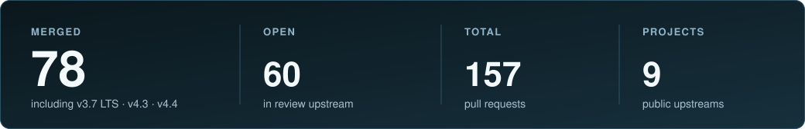

  

  
  
  
  
  

Embedded engineer and founder of [ArivEmb](https://arivemb.com),
[Devitwise](https://devitwise.com) and [Flowtly](https://flowtly.eu).

I take on the hard problems: the bug nobody can reproduce, the timing issue that
only shows up in the field, the new silicon with no driver yet. I dig until I
understand the root cause, then fix it properly, upstream when it belongs there.

Day to day that spans the whole embedded stack: MCU firmware on Zephyr RTOS and
the nRF Connect SDK, embedded Linux with Yocto, and FPGA. Recent work includes
Bluetooth LE Audio and Auracast, audio codecs, secure boot with MCUboot, fuzzing
and hardening network parsers, and bringing up new Microchip PIC32 parts in Zephyr.

## Upstream work

I fix what I hit in production upstream, so it stays fixed for everyone, including
the release branches people actually ship on.

  

<!-- stats:start -->
| Project | Focus | Merged | Open | Closed | Total |
|---|---|--:|--:|--:|--:|
| [Zephyr RTOS](https://github.com/zephyrproject-rtos/zephyr) | Microchip PIC32CZ CA and PIC32CM SG/GC bring-up, STM32H5 USB, display and touch, Efinix Sapphire, Bluetooth LE Audio and ISO, audio codec drivers, MCUmgr, hardened network parsers with libFuzzer harnesses | [62](https://github.com/zephyrproject-rtos/zephyr/pulls?q=is%3Apr+author%3ATheArkadiuszGrzelka+is%3Amerged) | [51](https://github.com/zephyrproject-rtos/zephyr/pulls?q=is%3Apr+author%3ATheArkadiuszGrzelka+is%3Aopen) | [18](https://github.com/zephyrproject-rtos/zephyr/pulls?q=is%3Apr+author%3ATheArkadiuszGrzelka+is%3Aclosed+is%3Aunmerged) | [131](https://github.com/zephyrproject-rtos/zephyr/pulls?q=is%3Apr+author%3ATheArkadiuszGrzelka) |
| [Google Bumble](https://github.com/google/bumble) | LE Audio ISO and BIG sync handling, SMP pairing correctness, serial resync | [4](https://github.com/google/bumble/pulls?q=is%3Apr+author%3ATheArkadiuszGrzelka+is%3Amerged) | [0](https://github.com/google/bumble/pulls?q=is%3Apr+author%3ATheArkadiuszGrzelka+is%3Aopen) | [0](https://github.com/google/bumble/pulls?q=is%3Apr+author%3ATheArkadiuszGrzelka+is%3Aclosed+is%3Aunmerged) | [4](https://github.com/google/bumble/pulls?q=is%3Apr+author%3ATheArkadiuszGrzelka) |
| [MCUboot](https://github.com/mcu-tools/mcuboot) | Serial recovery robustness, RISC-V boot fixes, simulator coverage | [4](https://github.com/mcu-tools/mcuboot/pulls?q=is%3Apr+author%3ATheArkadiuszGrzelka+is%3Amerged) | [1](https://github.com/mcu-tools/mcuboot/pulls?q=is%3Apr+author%3ATheArkadiuszGrzelka+is%3Aopen) | [0](https://github.com/mcu-tools/mcuboot/pulls?q=is%3Apr+author%3ATheArkadiuszGrzelka+is%3Aclosed+is%3Aunmerged) | [5](https://github.com/mcu-tools/mcuboot/pulls?q=is%3Apr+author%3ATheArkadiuszGrzelka) |
| [Zephyr Microchip HAL](https://github.com/zephyrproject-rtos/hal_microchip) | Register mappings for PIC32C and SAM peripherals: SERCOM, USART, SPI, USB, RTC | [4](https://github.com/zephyrproject-rtos/hal_microchip/pulls?q=is%3Apr+author%3ATheArkadiuszGrzelka+is%3Amerged) | [2](https://github.com/zephyrproject-rtos/hal_microchip/pulls?q=is%3Apr+author%3ATheArkadiuszGrzelka+is%3Aopen) | [0](https://github.com/zephyrproject-rtos/hal_microchip/pulls?q=is%3Apr+author%3ATheArkadiuszGrzelka+is%3Aclosed+is%3Aunmerged) | [6](https://github.com/zephyrproject-rtos/hal_microchip/pulls?q=is%3Apr+author%3ATheArkadiuszGrzelka) |
| [LVGL](https://github.com/lvgl/lvgl) | STM32 display drivers: LTDC D-cache on Cortex-M55, HAL callbacks, NemaGFX pool sizing, DMA2D and canvas | [3](https://github.com/lvgl/lvgl/pulls?q=is%3Apr+author%3ATheArkadiuszGrzelka+is%3Amerged) | [3](https://github.com/lvgl/lvgl/pulls?q=is%3Apr+author%3ATheArkadiuszGrzelka+is%3Aopen) | [0](https://github.com/lvgl/lvgl/pulls?q=is%3Apr+author%3ATheArkadiuszGrzelka+is%3Aclosed+is%3Aunmerged) | [6](https://github.com/lvgl/lvgl/pulls?q=is%3Apr+author%3ATheArkadiuszGrzelka) |
| [nRF Connect SDK](https://github.com/nrfconnect/sdk-nrf) | nRF Audio: codec integration and audio clock drift, MPSL in simulation | [1](https://github.com/nrfconnect/sdk-nrf/pulls?q=is%3Apr+author%3ATheArkadiuszGrzelka+is%3Amerged) | [2](https://github.com/nrfconnect/sdk-nrf/pulls?q=is%3Apr+author%3ATheArkadiuszGrzelka+is%3Aopen) | [0](https://github.com/nrfconnect/sdk-nrf/pulls?q=is%3Apr+author%3ATheArkadiuszGrzelka+is%3Aclosed+is%3Aunmerged) | [3](https://github.com/nrfconnect/sdk-nrf/pulls?q=is%3Apr+author%3ATheArkadiuszGrzelka) |
| [pylink](https://github.com/square/pylink) | J-Link version detection from the library file name | [1](https://github.com/square/pylink/pulls?q=is%3Apr+author%3ATheArkadiuszGrzelka+is%3Amerged) | [0](https://github.com/square/pylink/pulls?q=is%3Apr+author%3ATheArkadiuszGrzelka+is%3Aopen) | [0](https://github.com/square/pylink/pulls?q=is%3Apr+author%3ATheArkadiuszGrzelka+is%3Aclosed+is%3Aunmerged) | [1](https://github.com/square/pylink/pulls?q=is%3Apr+author%3ATheArkadiuszGrzelka) |
| [nrfx](https://github.com/nordicsemi/nrfx) | nRF5340 MDK: barrier after the UICR NFCPINS write | [0](https://github.com/nordicsemi/nrfx/pulls?q=is%3Apr+author%3ATheArkadiuszGrzelka+is%3Amerged) | [1](https://github.com/nordicsemi/nrfx/pulls?q=is%3Apr+author%3ATheArkadiuszGrzelka+is%3Aopen) | [0](https://github.com/nordicsemi/nrfx/pulls?q=is%3Apr+author%3ATheArkadiuszGrzelka+is%3Aclosed+is%3Aunmerged) | [1](https://github.com/nordicsemi/nrfx/pulls?q=is%3Apr+author%3ATheArkadiuszGrzelka) |
| [Renode](https://github.com/renode/renode-infrastructure) | Peripheral models: STM32H5 FDCAN | [0](https://github.com/renode/renode-infrastructure/pulls?q=is%3Apr+author%3ATheArkadiuszGrzelka+is%3Amerged) | [0](https://github.com/renode/renode-infrastructure/pulls?q=is%3Apr+author%3ATheArkadiuszGrzelka+is%3Aopen) | [1](https://github.com/renode/renode-infrastructure/pulls?q=is%3Apr+author%3ATheArkadiuszGrzelka+is%3Aclosed+is%3Aunmerged) | [1](https://github.com/renode/renode-infrastructure/pulls?q=is%3Apr+author%3ATheArkadiuszGrzelka) |

<b>Backports to release branches</b>

- Bluetooth: Controller: Do not pass NULL to memcpy in HCI reports: [v3.7 LTS (open)](https://github.com/zephyrproject-rtos/zephyr/pull/124076) [v4.4 (open)](https://github.com/zephyrproject-rtos/zephyr/pull/124075) [v4.5 (open)](https://github.com/zephyrproject-rtos/zephyr/pull/124077)
- Bluetooth: Controller: Fix ISO Sync Receiver BIS payload dereferencing: [v3.7 LTS](https://github.com/zephyrproject-rtos/zephyr/pull/123335)
- Bluetooth: Controller: Release held ISO Rx PDUs on BIG sync terminate: [v3.7 LTS](https://github.com/zephyrproject-rtos/zephyr/pull/123110) [v4.3](https://github.com/zephyrproject-rtos/zephyr/pull/123336) [v4.4](https://github.com/zephyrproject-rtos/zephyr/pull/123337)
- mgmt: mcumgr: os: refuse an echo request that carries no data: [v3.7 LTS](https://github.com/zephyrproject-rtos/zephyr/pull/118697) [v4.3](https://github.com/zephyrproject-rtos/zephyr/pull/118699) [v4.4](https://github.com/zephyrproject-rtos/zephyr/pull/118700)
- mgmt: mcumgr: transport: serial: Fix unaligned frame header read: [v3.7 LTS](https://github.com/zephyrproject-rtos/zephyr/pull/117128) [v4.3](https://github.com/zephyrproject-rtos/zephyr/pull/117127) [v4.4](https://github.com/zephyrproject-rtos/zephyr/pull/117124)
- net: tftp: reject a filename or mode too long for a request: [v4.4](https://github.com/zephyrproject-rtos/zephyr/pull/121503)
- net: tftp: terminate the error message before it reaches the callback: [v3.7 LTS](https://github.com/zephyrproject-rtos/zephyr/pull/121305) [v4.3](https://github.com/zephyrproject-rtos/zephyr/pull/121306) [v4.4](https://github.com/zephyrproject-rtos/zephyr/pull/121307)
- net: tftp: validate the source of every datagram the client receives: [v3.7 LTS](https://github.com/zephyrproject-rtos/zephyr/pull/120932) [v4.3](https://github.com/zephyrproject-rtos/zephyr/pull/120933) [v4.4](https://github.com/zephyrproject-rtos/zephyr/pull/120934)

<!-- stats:end -->

Public pull requests, refreshed daily. Counts include backports that carry my commits, also those opened by a bot or a maintainer. The number links list only the pull requests I opened; the rest are in the backport list.

## Projects

<table>
  <tr>
    <td width="50%" valign="top"><b><a href="https://www.atitan.tech">aTitan</a></b> splitR: Auracast and Bluetooth LE Audio broadcast audio. Zephyr / nRF Connect SDK firmware and the companion app.</td>
    <td width="50%" valign="top"><b><a href="https://arivemb.com">ArivEmb</a></b> Embedded intelligence: Zephyr board ports and drivers, Yocto, silicon enablement, device security.</td>
  </tr>
  <tr>
    <td width="50%" valign="top"><b><a href="https://flowtly.eu">Flowtly</a></b> ERP for service businesses that shows what every project actually earns.</td>
    <td width="50%" valign="top"><b><a href="https://devitwise.com">Devitwise</a></b> Engineering partner: embedded, backend, mobile, AI.</td>
  </tr>
</table>

## Stack

  

| | |
|---|---|
| **Languages** | C, C++, C3, Python, Bash |
| **Embedded** | Zephyr RTOS, nRF Connect SDK, Yocto / embedded Linux, FPGA, Renode |
| **Wireless** | Bluetooth Low Energy, LE Audio / Auracast, Wi-Fi, Thread, LTE-M, NFC |
| **Security** | secure boot, MCUboot, fuzzing |
| **DevOps** | Docker and containerization, CI pipelines |
| **AI / ML** | machine learning, edge inference, LLM tooling |
